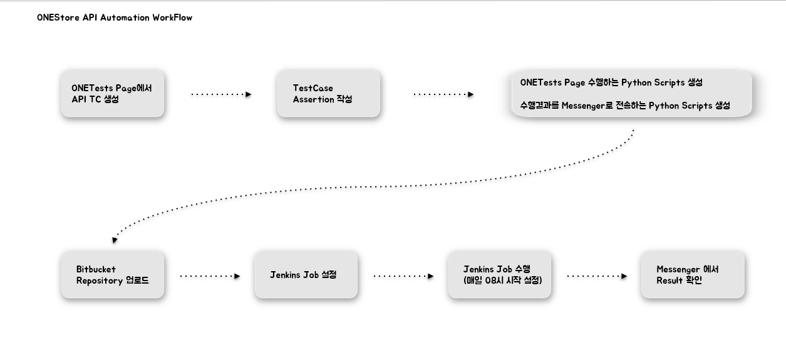
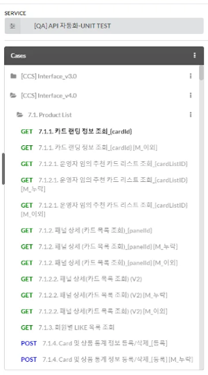
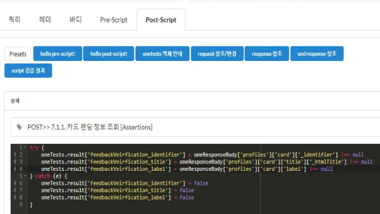
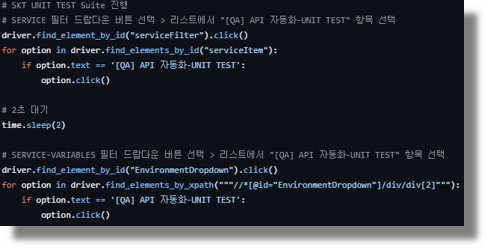
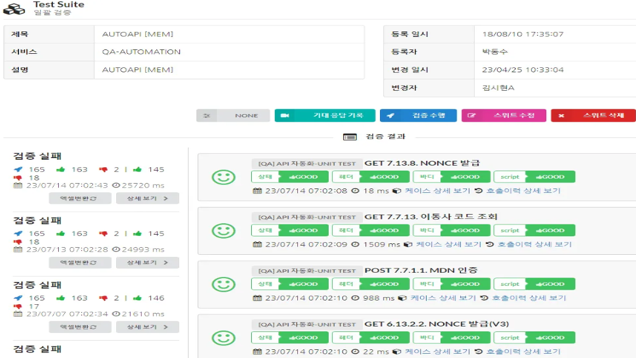
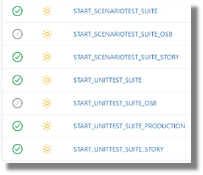
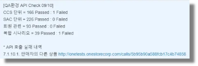

# Sample_Python_Auto_API_ONEStore

> ⚠️ **본 프로젝트는 포트폴리오용으로 제작된 샘플입니다.**
>
> 실무에서 진행한 API 회귀 테스트 자동화 작업을 바탕으로 재구성했으며,
> 보안 및 개인정보 보호를 위해 테스트 플랫폼 주소, 로그인 계정/비밀번호, 메신저(JANDI) Webhook URL, 작업자 이름 등
> 민감한 정보는 모두 제거하거나 임의의 값(`xxx`, `xxx.example.com` 등)으로 대체했습니다.
> 따라서 이 저장소의 코드는 실제 서버에 연결되어 동작하지 않습니다.

## 개요

사내 웹 기반 API 테스트 플랫폼(ONETests)에 등록된 **API 회귀 테스트 Suite**를 Selenium으로 자동 실행하고,
실행 결과를 수집해 **JANDI 메신저로 리포트**를 전송하는 Python 스크립트 모음입니다.
Jenkins Job으로 매일 08시에 실행해 QA/상용 환경의 API 상태를 매일 점검했습니다.

- 통신사(SKT / KT / LG U+)별 QA 환경 API **Unit Test / Scenario Test** Suite 일괄 실행
- OSB 환경, 상용(Production) 환경 API Suite 별도 실행
- Suite 결과 테이블에서 Pass/Fail 집계, 실패 케이스의 상세 호출 이력 링크 수집
- 결과를 요약해 JANDI Incoming Webhook으로 전송

## 자동화 WorkFlow



1. 테스트 플랫폼에서 API TestCase 생성
2. TestCase별 Assertion 작성
3. Suite를 실행하는 Python Script, 결과를 Messenger로 전송하는 Python Script 작성
4. Bitbucket Repository에 업로드
5. Jenkins Job 설정 후 매일 08시 실행
6. Messenger(JANDI)에서 결과 확인

## 기술 스택

| 구분 | 사용 도구 |
|---|---|
| 언어 | Python 2.7 |
| 웹 자동화 | Selenium WebDriver (ChromeDriver, Headless) |
| 결과 전송 | requests + JANDI Incoming Webhook |
| CI | Jenkins (Linux Agent, Headless Chrome) |
| 형상 관리 | Bitbucket |

## 프로젝트 구조

```
.
├── run_unittest_suite.py              # QA 환경 Unit Test Suite 실행 (SKT → KT → LG)
├── run_scenariotest_suite.py          # QA 환경 Scenario Test Suite 실행 (SKT → KT → LG)
├── run_unittest_suite_Production.py   # 상용 환경 Unit Test Suite 실행 (MEM / SAC / CCS)
├── get_unittest_result.py             # QA 환경 Unit Test 결과 수집 + JANDI 전송
├── get_scenariotest_result.py         # QA 환경 Scenario Test 결과 수집 + JANDI 전송
├── get_unittest_result_OSB.py         # OSB 환경 Unit Test 결과 수집 + JANDI 전송
├── get_scenariotest_result_OSB.py     # OSB 환경 Scenario Test 결과 수집 + JANDI 전송
└── get_unittest_result_Production.py  # 상용 환경 Unit Test 결과 수집 + JANDI 전송
```

## 테스트 구성

### TestCase



- SERVICE(`[QA] API 자동화-UNIT TEST` 등)별로 TestCase를 관리하고, 그 안에서 API 그룹(`[CCS]`, `[SAC]`, `[MEM]` 등)과 기능 단위로 폴더를 나눴습니다.
- 같은 API에 대해 정상 케이스와 파라미터 누락(`[M_누락]`), 잘못된 값(`[M_이외]`) 같은 예외 케이스를 함께 작성했습니다.

### Assertion



각 TestCase의 Post-Script에 응답 Body의 필수 필드가 있는지 검증하는 Assertion을 작성했습니다.

```javascript
try {
    oneTests.result['feedbackVeirification_identifier'] = oneResponseBody['profiles']['card']['_identifier'] !== null
    oneTests.result['feedbackVeirification_title'] = oneResponseBody['profiles']['card']['title']['_htmlTitle'] !== null
    oneTests.result['feedbackVeirification_label'] = oneResponseBody['profiles']['card']['label'] !== null
} catch (e) {
    oneTests.result['feedbackVeirification_identifier'] = false
    oneTests.result['feedbackVeirification_title'] = false
    oneTests.result['feedbackVeirification_label'] = false
}
```

## 동작 흐름

```
[Jenkins] ─▶ run_*_suite.py ─▶ 테스트 플랫폼 로그인 → Suite 선택 → 전체 실행 → 완료 대기
          └▶ get_*_result.py ─▶ 결과 테이블 파싱 → 실패 케이스 상세 수집 → JANDI 리포트 전송
```

### 1. Suite 실행 (`run_*_suite.py`)



1. Headless Chrome으로 테스트 플랫폼에 로그인합니다.
2. Suites 메뉴에서 **SERVICE 필터**와 **SERVICE-VARIABLES(환경 변수)** 를 통신사/환경에 맞게 선택합니다.
3. 전체 Suite 체크 후 실행하고, 확인 Alert를 수락합니다.
4. 새 탭을 열어 KT, LG Suite도 같은 방식으로 실행합니다.
5. `WebDriverWait`로 남은 케이스 수가 `Case(0/0)`이 될 때까지 기다려 Suite 완료를 확인합니다.

```python
driver.find_element_by_id("serviceFilter").click()
for option in driver.find_elements_by_id("serviceItem"):
    if option.text == '[QA] API 자동화-UNIT TEST':
        option.click()

# Suites 수행 완료까지 대기
WebDriverWait(driver, 1000).until(
    EC.text_to_be_present_in_element((By.XPATH, """//*[@id="app"]/div[2]/div/div[3]/div[1]/div[2]/label"""),
                                     'Case(0/0) :  ')
)
```

### 2. 결과 수집 및 리포트 전송 (`get_*_result.py`)



1. Suite 결과 테이블의 텍스트를 읽어 Suite별 **Total / Success / Fail / Script Fail / 수행 시간**을 파싱합니다.
2. Unit Test는 Suite 카테고리(`[ERR]` 예외, `[MEM]` 회원, `[SAC]`, `[CCS]`)별로, Scenario Test는 복합 시나리오 단위로 Pass/Fail을 집계합니다.
3. 실패가 있는 Suite는 상세 화면으로 들어가 각 API 호출의 **상태 / 헤더 / 바디 / Script** 4가지 판정 결과를 확인하고,
   `BAD` 판정이 있는 API의 이름과 **호출이력 상세 보기** 링크를 수집합니다.
4. 통신사별 결과를 하나의 메시지로 합쳐 JANDI Webhook으로 전송합니다.

```python
# 4가지 판정 요소(상태, 헤더, 바디, Script) 중 BAD가 있으면 실패 내역에 추가
check_bad = status + ' ' + header + ' ' + body + ' ' + script
if 'BAD' in check_bad:
    end_jandi_message += str(subject) + '\t' + str(call_link) + '\n'
```

## Jenkins Job



환경(QA / OSB / 상용)과 테스트 종류(Unit Test / Scenario Test)별로 Jenkins Job을 나눠 구성하고,
매일 08시에 자동 실행되도록 설정했습니다. 각 Job은 Suite 실행 스크립트(`run_*_suite.py`)를 실행한 뒤
결과 수집 스크립트(`get_*_result.py`)로 JANDI 리포트를 전송합니다.

## JANDI 리포트



Suite 카테고리별 Pass/Fail 집계와 함께, 실패한 API의 이름과 **호출이력 상세 보기** 링크를 메시지로 받아
담당자가 바로 실패 원인을 확인할 수 있도록 했습니다.

## 실행 방법

```bash
pip install selenium==3.141.0 requests

# 1. Suite 실행
python run_unittest_suite.py

# 2. 결과 수집 및 JANDI 전송
python get_unittest_result.py
```

- 실행 전 스크립트의 테스트 플랫폼 주소(`xxx.example.com`), 로그인 계정, JANDI Webhook URL을 실제 값으로 설정해야 합니다.
- Jenkins(Linux)에서는 `/chromedriver/chromedriver` 경로의 ChromeDriver를 Headless 모드로 사용합니다.
